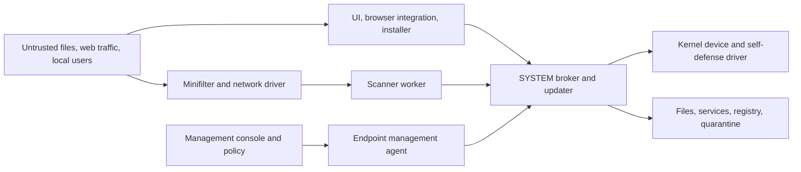

# Windows antivirus architecture and failure modes

## Abstract

Windows antivirus software is a collection of components that must inspect untrusted data while holding unusually broad powers: kernel execution, filesystem mediation, process control, network inspection, and SYSTEM service privileges. This combination creates recurring failure modes. The core analytical task is to identify where a lower-trust actor controls data or object identity, where a more privileged component consumes it, and what capability crosses that boundary. The CVE studies linked from the skill give concrete instances across consumer antivirus, enterprise endpoint agents, and tools installed with security suites.

Windows endpoint protection usually has several independently privileged components. An issue in a scan engine, updater, kernel driver, or management plane can have very different consequences even when the same product name appears in an advisory. A process crash, a disabled scanner, arbitrary file deletion, SYSTEM code execution, and kernel code execution are separate observations. Claims about “protected process” termination require still more precision because Windows service permissions, vendor self-defense, and AM-PPL are separate mechanisms.

## System model



The diagram expresses trust and authority, not a required design for every vendor. In an actual installation, components may be combined, absent, or provided by different vendors. The vendor's binary and service inventory decides which arrows exist. The threat actor may be a normal local user, an administrator, malicious content awaiting a scan, a compromised management console, or an attacker able to supply a signed vulnerable driver. Those are different starting positions. A valid finding specifies one position and one reachable path through the graph.

The most important distinction is **input control versus operation authority**. A normal user may control a file name, file contents, temporary directory, registry value, COM registration, or IPC endpoint without having permission to delete protected files or execute as SYSTEM. If an AV component with that authority acts on the user's input without preserving the intended object and authorization, the AV itself becomes a privilege broker. Conversely, a kernel driver can be vulnerable even with perfectly protected files if its request handler reads mutable caller memory twice or exposes a powerful operation to a weakly authorized handle.

## Kernel and process protection

**Kernel drivers.** File-system minifilters inspect or modify file I/O, often during create, read, write, and cleanup operations. Drivers may also register process, thread, image-load, or registry callbacks; intercept network traffic; or expose device objects and IOCTLs to user mode. The risk is high because a kernel memory error can crash Windows or permit kernel execution. The relevant boundary is the driver device's access policy *and* each request handler's authorization, buffer lengths, pointer handling, object lifetime, and use of caller-controlled data. A `FILE_ANY_ACCESS` IOCTL can be invoked with only minimal device-handle access unless the driver checks more strictly at runtime. See Microsoft's [minifilter model](https://learn.microsoft.com/en-us/windows-hardware/drivers/ifs/filter-manager-concepts), [IOCTL access check](https://learn.microsoft.com/en-us/windows-hardware/drivers/ddi/wdmsec/nf-wdmsec-wdmlibiovalidatedeviceiocontrolaccess), and [driver security guidance](https://learn.microsoft.com/en-us/windows-hardware/drivers/driversecurity/driver-security-checklist). Avast/AVG's anti-rootkit driver double fetch and Avast's sandbox-driver overflow are concrete cases in the catalog.

**Signed vulnerable drivers and self-defense.** A legitimately signed driver can become a route to kernel privileges or security-tool tampering if its accessible interface exposes unsafe operations. Driver signature alone does not establish safe behavior. Microsoft's [vulnerable driver blocklist](https://learn.microsoft.com/windows/security/threat-protection/windows-defender-application-control/microsoft-recommended-driver-block-rules) exists for this class of issue. A product's self-defense driver is itself an attack surface; a bug there can cross from user mode to kernel mode or undercut the process protection it enforces.

The vulnerable driver need not belong to the antivirus being disabled. OPSWAT's [CVE-2026-36425 advisory](https://www.opswat.com/blog/security-update-addressing-the-opswat-legacy-appremover-driver-and-cve-2026-36425) says its legacy signed AppRemover driver could terminate protected security processes when invoked by an unprivileged local caller. [Observed malware](https://www.acronis.com/en/tru/posts/cambodia-focused-cluster-uses-multi-stage-infection-chain-with-localized-lures/) used that driver against several AV products. That is a driver authorization defect in OPSWAT's component and an external tampering path for the products it targeted; it is not, on those facts alone, a separate CVE in each target product.

**Ordinary service, vendor self-defense, and AM-PPL are different.** Windows service DACLs determine who can stop or reconfigure a service. Vendor self-defense may add driver-enforced restrictions. Windows antimalware protected services (AM-PPL) require the documented ELAM and signing integration and restrict unprotected processes, including administrator processes, from writing memory or injecting code. This is a narrower guarantee than "cannot fail": an application-level crash, service logic, or kernel compromise can still affect availability. Do not call a process protected merely because its UI displays a lock or a stop command failed. See Microsoft's [service rights](https://learn.microsoft.com/en-us/windows/win32/services/service-security-and-access-rights) and [protected antimalware service model](https://learn.microsoft.com/en-us/windows/win32/services/protecting-anti-malware-services-).

For a reported "admin/ring 3 can terminate the protected process," establish the actual protection level and method of termination. Direct `TerminateProcess` against AM-PPL from an ordinary administrator process would be a different finding from inducing the service to crash with malformed input, using its own control channel to shut it down, or first gaining kernel execution. The catalog's Avast AM-PPL chain illustrates how a PPL-specific boundary can be crossed only after other privileges are obtained.

## Privileged user-mode components

**Service RPC, COM, named pipes, and local sockets.** SYSTEM services often accept commands from the UI, management agent, updater, or sandbox. A method that creates files, changes protection settings, launches a process, or returns a privileged handle needs authorization based on the *calling identity and request*, not a caller-supplied path, PID, or assumed origin. Impersonation and pipe-server identity matter. Avast internal service methods, AVG COM hijacking, and Quick Heal's named-pipe case show distinct failures. A service being reachable from an unprivileged account does not imply a vulnerability; the requested operation and access check decide it.

**Paths and file operations.** Scanners, quarantine restore, repair, cleanup, shredder, backup, installers, and updaters legitimately manipulate files with elevated privileges. Trouble arises when a less-privileged actor can redirect the source or target with a junction, symbolic link, hard link, writable directory, traversal, or a time-of-check/time-of-use change. Consequences range from one arbitrary file deletion to SYSTEM code execution, depending on what file is reached and subsequent behavior. State only the outcome supported by the advisory. The repeated ESET, Panda, Comodo, G DATA, Bitdefender, and Avast cases show that the same boundary reappears in different features. A sound implementation keeps the privileged operation bound to the object and authorization originally intended; a string path check alone is not always enough.

**Search paths, configuration, and permissions.** Privileged services that load DLLs, executables, COM classes, scripts, or configuration from user-writable locations can grant code execution to a lower-privileged actor. Bitdefender's `seccenter.exe` configuration case, ESET Inspect Connector's custom configuration/DLL case, and G DATA's writable autostart directory are examples. The inverse failure also matters: a low-privilege caller may change antivirus settings or exclusions without gaining SYSTEM, as in Quick Heal's settings case.

**Network and browser inspection.** Web protection can use browser extensions, injected libraries, local proxies, TLS interception, or Windows network filtering. These components can ingest remote content inside a browser or a security process, alter the browser's integrity boundary, or become a trusted TLS intermediary. Avast Script Shield's library corruption case and Bitdefender's HTTPS-certificate validation case illustrate different consequences. The analysis should identify which process performs parsing or certificate checks before claiming a browser sandbox escape, traffic interception, or remote code execution.

**Management plane and response tools.** Endpoint agents can execute administrator-supplied actions, install updates, or receive policies from a console. The console-to-agent route is intentionally powerful; local temporary files, credentials, command staging, and authorization between tenants, roles, and endpoints therefore matter. ESET's management-agent temporary batch-file case required local administrator rights and illustrates an administrator-to-SYSTEM boundary, not a standard-user elevation. Do not equate a vulnerability in a vendor's unrelated web service with a Windows endpoint vulnerability.

## Scanning and update reliability

**Untrusted file parsing.** AV engines process executable formats, archives, scripts, documents, and data embedded in other files, sometimes automatically. Malformed input can cause a scanner-process crash, infinite loop, memory corruption, or code execution. A crash of an isolated worker is not automatically an operating-system crash or a lasting loss of protection; inspect worker restart, fail-open/fail-closed behavior, and which protection path was affected. A parser for a non-Windows format can still affect Windows if the Windows engine scans that file type. Kaspersky's 2022 parsing case, F-Secure's unpacker crash, and Avira's PE parser case demonstrate different impacts.

**Updates and installation.** Antivirus products update engine code, drivers, signatures, and policy through different channels. Fixing one does not establish that every installed component is current. Update, repair, uninstall, and rollback code frequently runs elevated and touches user-accessible paths. A package or content change can also cause a fleet-wide reliability failure without a CVE. CrowdStrike's [July 2024 incident review](https://www.crowdstrike.com/en-us/blog/falcon-content-update-preliminary-post-incident-report/) describes a rapid-response content update that led to Windows crashes. Huorong's 2024 driver-blocklist and false-positive incidents in the catalog show compatibility and detection failures. These are operational failure examples, not proof of a product CVE.

Where the updater fetches remote content, the trust boundary also includes transport authentication, package authenticity, version selection, and what privileged service consumes the result. Examine those properties only for an updater that actually exists in the product being assessed; product names alone do not prove a network update path.

## How the Windows mechanisms create these boundaries

### Filter drivers are in the path of ordinary activity

A filesystem minifilter registers preoperation or postoperation callbacks with Filter Manager. Its altitude determines its position relative to other filters; it can observe, modify, block, or defer selected file operations. That makes file opening, saving, downloading, unpacking, and deleting potential inputs to a security product even when nobody intentionally launches an antivirus scan. The filter may ask a user-mode scanning service for a verdict, which adds a kernel-to-user and user-to-kernel control loop. A bad verdict, stalled response, or worker crash can affect the original file operation and protection availability. Microsoft's [Filter Manager concepts](https://learn.microsoft.com/en-us/windows-hardware/drivers/ifs/filter-manager-concepts) and [minifilter altitude documentation](https://learn.microsoft.com/en-us/windows-hardware/drivers/ifs/load-order-groups-and-altitudes-for-minifilter-drivers) explain the callback model.

The driver may also register process and thread handle callbacks to restrict attempts to open protected product processes. Microsoft's [`ObRegisterCallbacks`](https://learn.microsoft.com/en-us/windows-hardware/drivers/ddi/wdm/nf-wdm-obregistercallbacks) documentation describes that mechanism. It controls selected object-handle operations; it does not turn all user-mode service methods or file paths into trusted ones. A low-privilege process may fail to open the AV service yet still be able to feed it an untrusted path through a separate interface. Conversely, a third-party kernel driver with an exposed termination function can circumvent a user-mode handle restriction, as the OPSWAT case shows.

Network inspection adds another kernel-facing path. Windows Filtering Platform callouts may inspect, modify, or reinject traffic at layers of the TCP/IP stack. Microsoft's [WFP callout overview](https://learn.microsoft.com/en-us/windows-hardware/drivers/network/introduction-to-windows-filtering-platform-callout-drivers) expressly includes antivirus inspection. A WFP callout bug may affect network availability or kernel memory, while a local TLS interception proxy's certificate-validation bug affects connection authenticity. These are separate even if sold as one “web shield.”

### Names are not the same as objects

Windows reparse points can redirect file opens. Junctions, symbolic links, mount points, and other reparse tags make a textual path a request to resolve an object, rather than an immutable reference to the object checked earlier. Microsoft's [reparse-point overview](https://learn.microsoft.com/en-us/windows/win32/fileio/reparse-points) and [file-operation guidance](https://learn.microsoft.com/en-ca/windows/win32/fileio/reparse-points-and-file-operations) document this behavior. Hard links present a different aliasing issue: two names can identify the same underlying file. Ordinary string normalization does not settle object identity or whether a later open reaches the same target.

The recurring AV sequence is: a lower-privilege user controls a directory entry; the product validates or records a path; time passes or a separate component is invoked; a SYSTEM service opens or deletes the name again. At the final operation, the name may resolve to a different object. The impact depends on the operation and target. Deleting a protected file may create a service outage or enable a later privileged load; creating a DLL at a trusted path may allow execution; overwriting a settings file may disable protection. The ESET, Panda, Tencent, and Comodo case studies show variations of this sequence. A repair or quarantine UI can add an administrator interaction requirement, which materially changes exploitability.

The design principle is to keep an authorized operation bound to the object actually intended and to treat each path component crossing a writable directory as a potential change of object identity. The implementation depends on the operation: opening the reparse point itself, applying appropriate ACLs, using a handle to the intended object, or staging in a service-owned directory may be suitable in different cases. Merely adding path-prefix comparisons has repeatedly failed because the prefix is checked before the final object is selected.

### A sandbox has more than one boundary

An AV scan worker may be sandboxed to contain parser defects. That helps only if other local processes cannot tamper with the worker and the worker cannot command a more privileged broker into doing forbidden work. Windows enforces access through both a token and security descriptors on process, thread, file, registry, and IPC objects. A restricted SYSTEM token can still carry an identity other system services treat as highly privileged, as the Avast scanner chain demonstrates. The sandbox's filesystem restrictions and its IPC authority must be analyzed separately. Scanner code also needs a recovery policy: if the worker crashes on one file, does the filter block the file, allow it, retry, restart the worker, or disable a protection module? The CVE record rarely answers all of these deployment questions.

### The meanings of “protected”

An ordinary Windows service is controlled by its service object's security descriptor. The Service Control Manager checks rights such as `SERVICE_STOP` and `SERVICE_CHANGE_CONFIG`; Microsoft's [service rights](https://learn.microsoft.com/en-us/windows/win32/services/service-security-and-access-rights) show which actions a caller may request. Vendor self-defense can add separate driver enforcement on process handles, registry values, files, and filter unload. AM-PPL is a Windows protected-service mode requiring an ELAM-integrated registration and signed-code rules; Microsoft's [antimalware service documentation](https://learn.microsoft.com/en-us/windows/win32/services/protecting-anti-malware-services-) states that nonprotected administrator processes cannot simply inject into or write the protected service's memory.

These layers do not guarantee continued execution under all conditions. A protected service can still contain a parser bug or respond to an authorized management command. A faulty filter can be blocked by Windows policy. An attacker who has already gained a vulnerable kernel-driver capability can target security processes from the kernel. A report that “an admin terminated a protected process” therefore needs the actual process protection level and method before it can be interpreted. Direct user-mode handle use against AM-PPL would challenge a different boundary from making the process exit through its own bug. The distinction is central to the OPSWAT, Avast AM-PPL, and Avast minifilter cases.

### Distinct update streams alter exposure

An AV product may ship a large installer, smaller product builds, engine modules, detection databases, driver packages, browser integration, and centrally managed policy. The fixes in the case studies arrived through all of these streams. ESET corrected some file operations via Cleaner or HIPS module updates, while its installer-only issue required corrected installers or package generation. Kaspersky fixed one parser issue through antivirus databases. Symantec provided maintenance releases for the Windows client. A security advisory's “fixed version” must therefore be interpreted as the version of the *affected component*, not automatically the visible marketing product number.

An update pipeline can also be a source of failure when its content is trusted by privileged code. The CrowdStrike incident showed a content validator accepting a record the sensor interpreter could not safely consume. A fix can require matching the producer schema, runtime parser, deployment process, and rollback behavior. This is a reliability boundary even without an external adversary. Huorong's false positive and blocked-driver incidents show two other routes by which protection software can disrupt a host: a bad detection decision and an operating-system compatibility control.

## Evidence and interpretation

An advisory gives one or more of four kinds of evidence: (1) the **affected product and versions**; (2) the **reachable input and prerequisites**; (3) the **primitive**, such as arbitrary deletion or memory corruption; and (4) the **demonstrated impact**, such as SYSTEM execution. They should be recorded separately. The presence of a CVE or high CVSS score does not fill gaps in a short advisory. For example, Kaspersky's 2022 parser advisory names an ordinary local user's potential code execution but does not disclose a file-format recipe, while Broadcom's SEP notice does not name a root-cause component at all. Inventing one would make the analysis appear more precise than its sources.

The boundaries most often confused are user-to-admin, user-to-SYSTEM, admin-to-SYSTEM, SYSTEM-to-AM-PPL, user-to-kernel, and remote-content-to-local-scanner. Each has a different prerequisite and consequence. “Can stop protection” may mean a settings change, an engine crash, a driver unload, or kernel-mediated termination. “Can exploit remotely” may mean an exposed management service, or merely a malicious file delivered over a network before local scanning. These distinctions preserve the strongest conclusion the evidence supports.

For a concrete installed product, read-only Windows inventory can ground the model before inspecting its code or advisories:

```powershell
# Read-only examples; product names and paths vary by installation.
Get-CimInstance Win32_Service |
  Where-Object { $_.DisplayName -match 'Antivirus|Endpoint|Security' } |
  Select-Object Name, DisplayName, State, StartName, PathName

Get-CimInstance Win32_SystemDriver |
  Where-Object { $_.DisplayName -match 'Antivirus|Endpoint|Security' } |
  Select-Object Name, State, PathName

fltmc filters
```

The service inventory shows declared service accounts and binary paths; the driver inventory and `fltmc` reveal loaded drivers and filesystem filters. None of these commands proves AM-PPL status, an IOCTL authorization failure, or a vulnerable version by itself. Their use is to identify *which components actually exist* so deeper analysis can stay tied to the installation.

## Cross-case findings

**Privileged file primitives are the dominant repeated pattern in these disclosures.** The same authority crossing appears in ESET real-time cleanup and installers, Panda's host service, G DATA backup and setup, Comodo quarantine and updater, Tencent temporary-file cleanup, Avast repair, AVG update, Bitdefender File Shredder, and Microsoft's Defender engine. Their triggers differ, but each product has a legitimate reason to manipulate files at elevated privilege. The vulnerability is in which actor chooses the final object. Fixing one feature does not show that other features use the same safe file-operation path.

**The strongest protections are themselves code and policy.** A scanner sandbox introduces process DACL and IPC questions. A self-defense driver introduces a kernel device interface and callback policy. AM-PPL restricts ordinary administrator tampering but requires correct signing and registration, and it does not make the service's own parser infallible. The Avast chain and OPSWAT driver case demonstrate two different ways a protection boundary can be crossed. Both are better explained as concrete transitions between authorities than as a generic “AV bypass.”

**The outcome is often narrower than the label.** Several cases grant file deletion or creation, not immediate code execution. Some require a separate administrator action, high initial privilege, or self-protection disabled. Quick Heal's settings flaw changes product policy without OS elevation; Kaspersky Safe Money can be disabled without a SYSTEM token; F-Secure scanner crashes primarily affect availability. Reporting the primitive and prerequisite separately preserves the real impact without forcing it into a standard escalation story.

**Branding is weaker evidence than component lineage.** Gen Digital's shared Norton/Avira/Avast/AVG advisory and WatchGuard's Panda/EPDR advisory identify actual shared code or product sets. Other same-brand products do not inherit those CVEs automatically. Symantec-branded server tools, for example, are distinct from SEP Windows client. A useful case study therefore includes product line, component, version, and platform before any statement about a vendor.

**A protection product can fail even when no adversary exploited it.** CrowdStrike's content-update BSOD, Huorong's `explorer.exe` false positive, and Windows policy blocking Huorong drivers caused real supported-product failures. These belong in the reliability and detection-quality analysis alongside CVEs, but they should remain labeled as incidents rather than assigned an invented vulnerability identifier. A product that protects endpoints at scale needs both vulnerability resistance and safe behavior when its own data or operating environment changes.

## Impact language

- **Tampering or bypass:** a protection setting, verdict, exclusion, or self-defense control changes against policy. This need not yield code execution.
- **Availability:** scanner worker exits, protection service stops, update fails, or Windows crashes. Record the affected layer and whether the effect persists or recovers.
- **Privileged file operation:** arbitrary read, create, overwrite, move, or delete. A file primitive can enable privilege escalation but does not prove that escalation unless the case demonstrates the follow-on effect.
- **Local elevation:** ordinary user to administrator/SYSTEM, administrator to SYSTEM, or SYSTEM to AM-PPL are different boundaries. A kernel bug crosses a further boundary.
- **Remote exposure:** distinguish a network-reachable management service from malicious content that reaches the local scanner through a separate delivery path. Neither the vendor name nor a CVSS vector alone proves remote exploitability of a particular deployment.

## Limitations

The examples are historical and product-specific. Vulnerability databases sometimes publish a CVE years after discovery, summarize an impact more broadly than a vendor advisory, or omit a prerequisite. For operational decisions, use the affected component's installed version and the cited advisory rather than assuming an entire vendor portfolio shares a defect.
